# Comparativo Visual Antes vs Depois (`Pedra e Pergaminho`)

Este documento apresenta lado a lado os prints **Antes** (`docs/design/antes/`) e **Depois** (`docs/design/depois/`) de cada tela no **Celular (`390×844`)** e no **PC (`1440×900`)**, além dos vídeos/GIFs das animações de cada lote.

---

## Fase 2 — Base & Vitrine (`/design`)

- **Vídeo das animações:** `docs/design/depois/fase2_design_animacoes.webm`

| Tela / Dispositivo | Antes | Depois |
|---|---|---|
| **Vitrine `/design` (Celular 390×844)** | 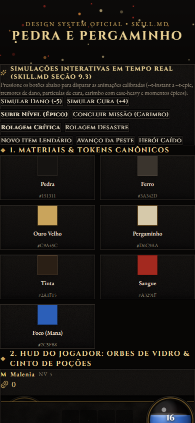 | 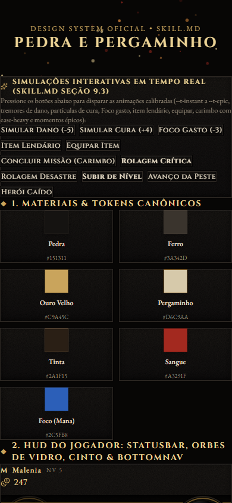 |
| **Vitrine `/design` (PC 1440×900)** | 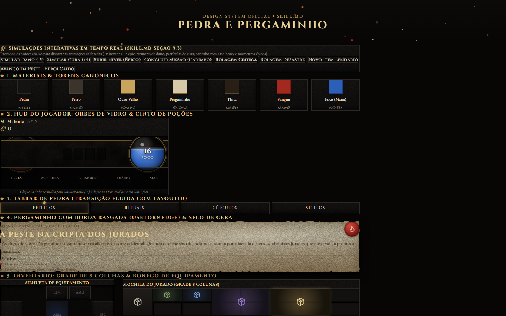 | 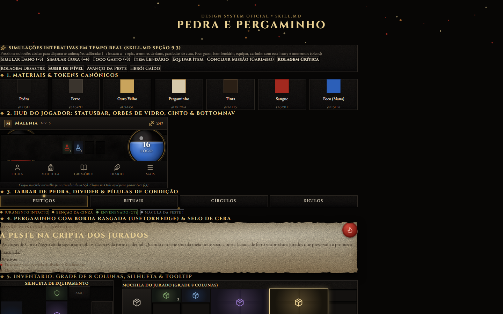 |

---

## Lote A — Jogador: HUD, Ficha e Mochila

- **Vídeo das animações:** `docs/design/depois/loteA_jogador_animacoes.webm`

| Tela / Dispositivo | Antes | Depois |
|---|---|---|
| **Ficha `/jogador/ficha` (Celular 390×844)** | 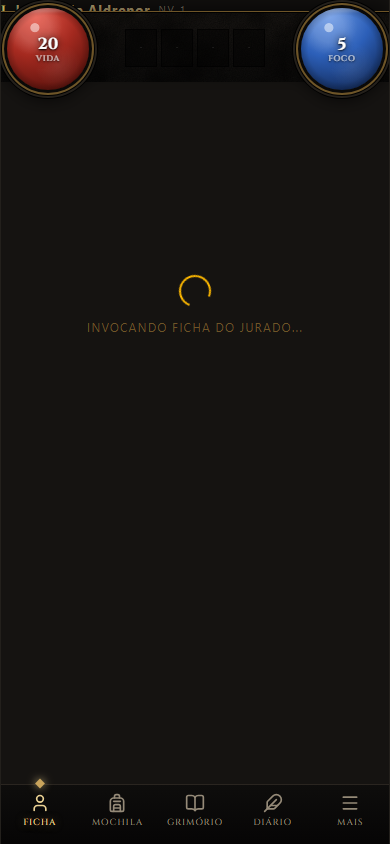 |  |
| **Ficha `/jogador/ficha` (PC 1440×900)** | 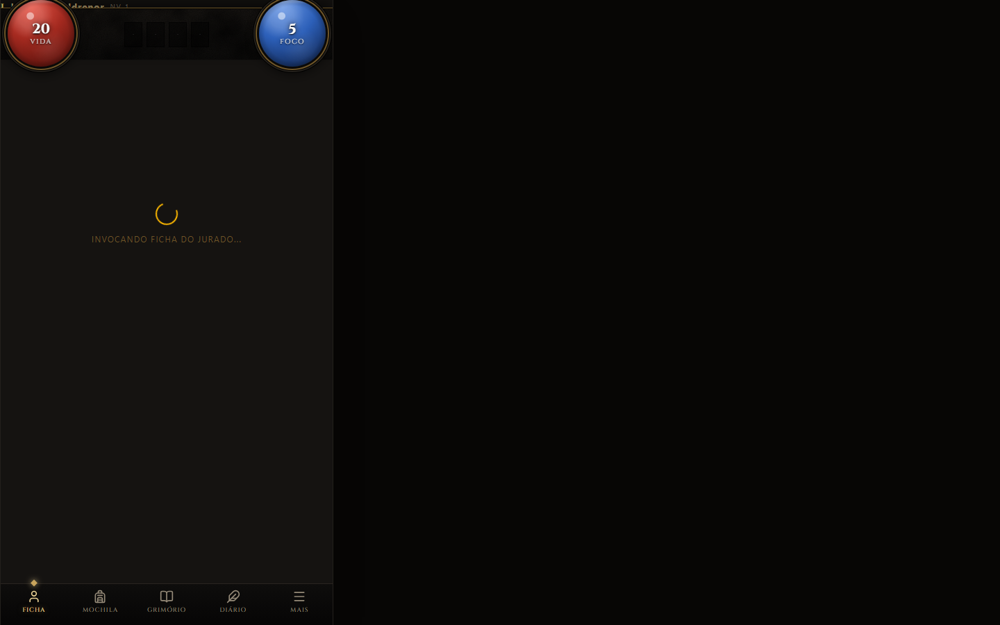 | 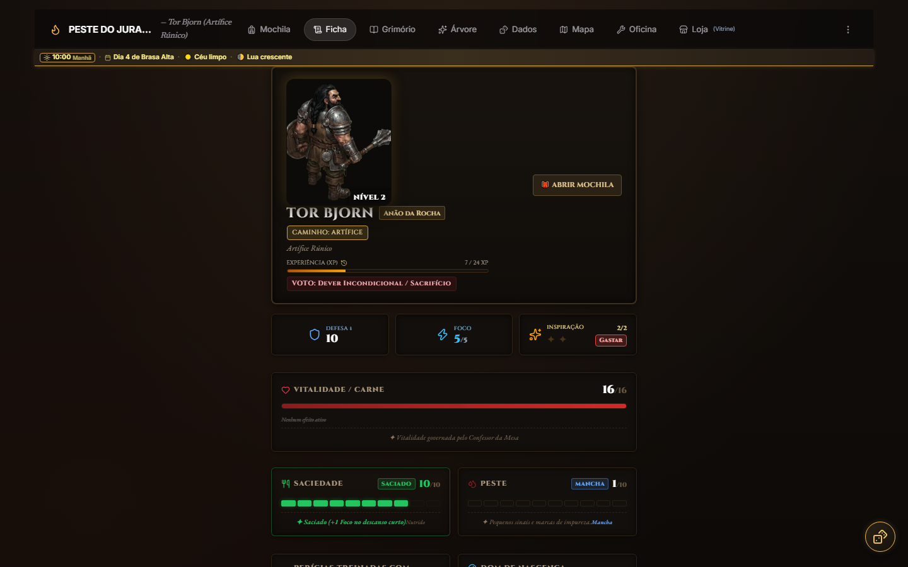 |
| **Menu "Mais" do HUD (Celular 390×844)** | 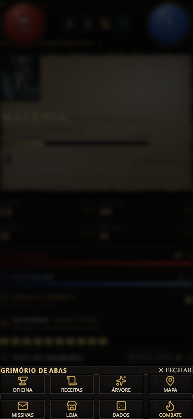 |  |
| **Menu "Mais" do HUD (PC 1440×900)** | 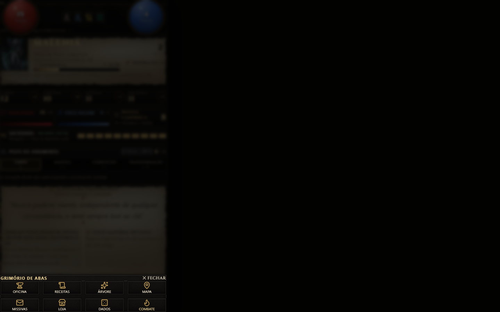 |  |
| **Mochila `/jogador/mochila` (Celular 390×844)** | 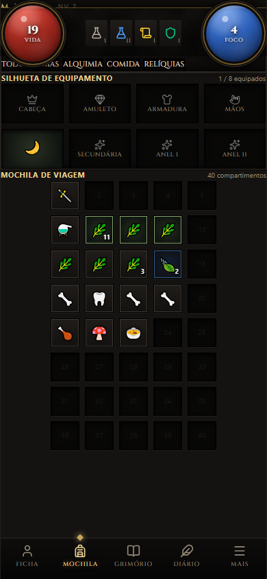 |  |
| **Mochila `/jogador/mochila` (PC 1440×900)** | 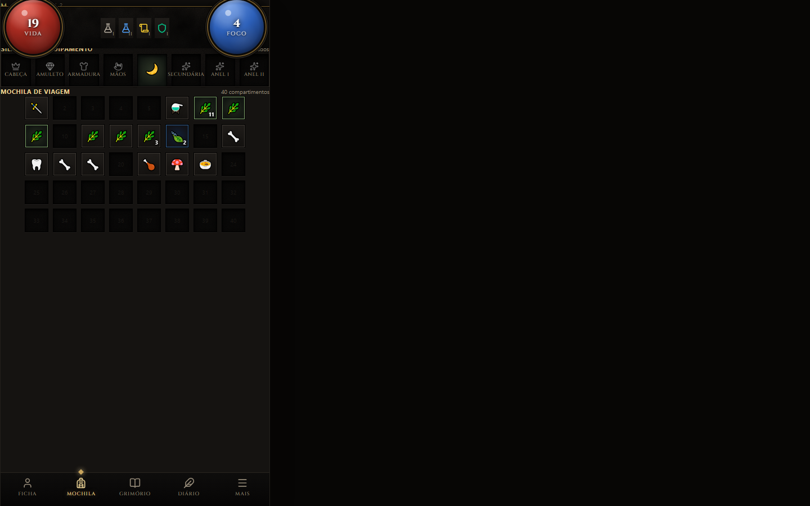 |  |
